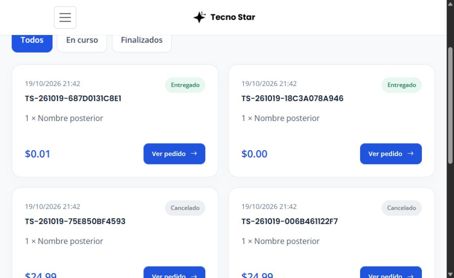
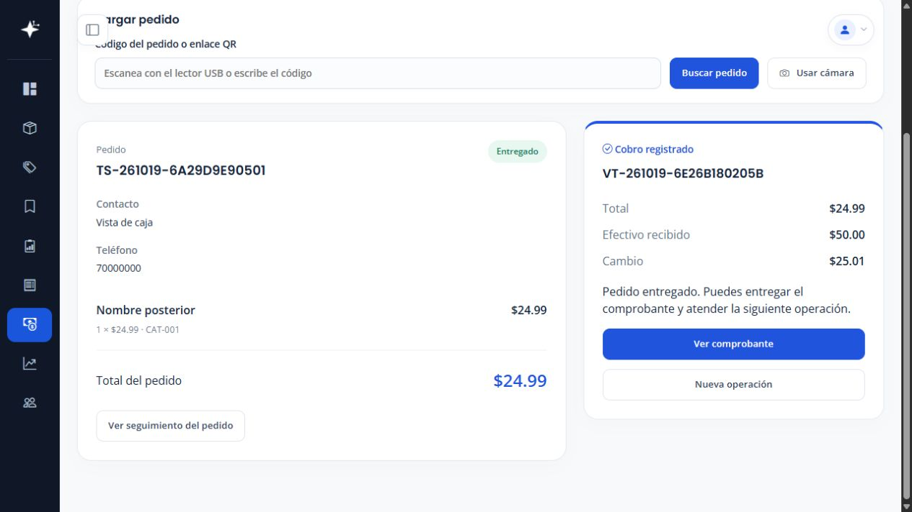

# Pedidos, Caja y reinversión

Implementación del 19 de octubre de 2026. El código y las pruebas aisladas están terminados. La activación SQL de reinversión en la instalación real se completó tras la autorización expresa del usuario, con copia previa y permisos mínimos verificados.

Actualización de correos: al marcar «Listo para retirar» se envía el aviso de retiro y se abre el detalle del pedido; Caja se abre manualmente para cobrar. La migración 008 necesaria para conservar por separado los envíos de confirmación/retiro está activada y verificada tras autorización expresa, con copia previa, datos conservados y permisos sin cambios. No se generaron correos históricos durante la activación. El [estado general](ESTADO_PROYECTO_2026_10_19.md) recoge las tareas de publicación pendientes.

## Recorrido del personal

1. **Pedidos → Pendientes:** abrir el detalle y aceptar o cancelar con motivo. Aceptar encola el QR conforme al módulo de correo existente.
2. **Confirmados:** iniciar preparación y marcar listo. El enlace para volver conserva la bandeja del estado actual.
3. **Caja:** entrar desde el pedido o leer su código con USB, cámara o entrada manual. El escaneo carga los datos y dirige a la sección del pago. Si está confirmado, se puede iniciar la preparación y marcar listo desde Caja, conservando las validaciones e historial de cada paso.
4. Con los productos listos, introducir **Efectivo recibido**, comprobar el cambio y pulsar **Registrar pago**. El modal **Confirmar pago y entrega** guarda conjuntamente venta, importe recibido, cambio, entrega, inventario y reinversión. Solo entonces aparece en Ventas.
5. Consultar el comprobante o iniciar una nueva operación. El pedido entregado aparece en **Historial**; su venta aparece en **Ventas**.
6. **Ventas → Reinversión:** administración consulta distribución histórica y acumulados del período. Anular una venta conserva su distribución, pero la excluye de los acumulados vigentes.

El lector USB debe funcionar como teclado y terminar su lectura con Enter. La cámara necesita localhost o HTTPS y permiso del navegador; hay selección de dispositivo y apagado explícito. Se detiene al ocultar o abandonar la página. La comprobación física del equipo del negocio sigue pendiente.

## Acceso por rol

| Acción | Administrador | Empleado con permiso de pedidos/caja | Cliente |
| --- | --- | --- | --- |
| Bandejas y preparación | Sí | Sí | No |
| Caja, escaneo y cobro | Sí | Sí | No |
| Ventas del negocio | Sí | Sí | No |
| Reinversión, resumen y desglose | Sí | No | No |
| Anulación y reembolso | Sí | No | No |
| Pedidos y compras propios | Sí | Sí | Sí |
| Cancelación del pedido propio | Según transición válida | Según transición válida | Pendiente o confirmado |

El permiso se comprueba en el servidor, también por URL directa. No basta con ocultar enlaces. Los campos de reinversión no se incluyen en las respuestas del cobro ni en los comprobantes del empleado o del cliente.

## Cliente

`/orders` presenta cuatro tarjetas por página, en dos columnas de escritorio y una de móvil. Los filtros Todos/En curso/Finalizados, los conteos y la paginación se consultan en SQL para el propietario autenticado. Solo las reservas activas muestran vencimiento. La cancelación abre una confirmación desde el detalle; desaparece al comenzar la preparación.

## Garantías del cobro

Los importes del servidor usan centavos enteros. Venta, distribución, entrega, liberación de reserva, descuento físico e historial comparten una transacción. Se valida pedido listo, reserva vigente, usuario autorizado, efectivo suficiente y solicitud única.

Cada solicitud conserva pedido, usuario e importe en el navegador. Ante una respuesta incierta, Caja bloquea la edición y permite consultar el resultado; si aún no existe, ofrece reintentar exactamente la misma solicitud. El bloqueo SQL y las claves únicas impiden dos ventas del mismo pedido incluso entre empleados distintos. Recargar una página o volver a escanear no cobra automáticamente.

## Reinversión

La base es el total histórico de la venta. Se guardan porcentajes por operación: 50 % reposición y 5 % crecimiento. Los importes generados conservan el redondeo del SQL original:

```text
reposición = round(base × reposición% / 100, 2)
reinversión = round(base × (reposición% + crecimiento%) / 100, 2)
crecimiento = reinversión − reposición
```

Una venta de $24.99 genera $12.50 + $1.24 = $13.74 de reinversión. Recibir $50.00 produce $25.01 de cambio y no cambia esa base. El importe restante no representa la ganancia neta.

La migración 007 crea o adopta `tbreinversiones`; comprueba InnoDB, columnas calculadas, redondeo y unicidad de venta. Conserva registros anteriores y sus porcentajes, sin reconstruir ventas históricas. El reporte identifica cobros anteriores pagados que carecen de distribución.

## Activación local verificada

La inspección de la instalación encontró `tbreinversiones` compatible y vacía, con cero ventas existentes. `CHECK TABLE` respondió correctamente en todas las tablas del proyecto. El arranque de MariaDB emitió avisos de LSN/páginas de InnoDB; este trabajo no reparó ni reconstruyó archivos del servidor.

La revisión automática rechazó inicialmente la activación por falta de autorización expresa del permiso financiero SELECT/INSERT. El usuario aprobó después esa ampliación concreta y se ejecutó `database/enable-reinvestment.php`: creó la copia SQL privada completa y la copia de los permisos anteriores, adoptó el esquema y concedió exclusivamente SELECT/INSERT sobre esta tabla. La comparación de cuentas, claves, ventas, pedidos, saldos y reinversiones anteriores confirmó que se conservaron. No se concedió UPDATE/DELETE sobre reinversión.

Comandos ejecutados después de la aprobación:

```powershell
C:/xampp/php/php.exe database/enable-reinvestment.php --apply
C:/xampp/php/php.exe database/enable-reinvestment.php --verify
```

Ambos comandos terminaron correctamente. También se comprobó con la cuenta real de la aplicación que `ReinvestmentModel::enabled()` devuelve verdadero; Caja ya reconoce la habilitación. La copia SQL terminó sin errores. No se realizaron cobros reales de prueba ni se cambiaron contraseñas; el único permiso de aplicación ampliado fue SELECT/INSERT sobre reinversión.

## Verificación

- Instalación limpia y migración repetible: `tests/database.php`.
- Compatibilidad canónica y antigua, incluidas reinversiones anteriores con porcentajes 40/10: `tests/sales-accounts-upgrade.php`.
- Activador completo y copia previa: `tests/reinvestment-enable.php`, exclusivamente sobre una base nueva y una cuenta sintética del puerto 13308. La instalación real no se activa mediante esta prueba.
- Regresión de catálogo, inventario, carrito, pedidos, cuentas y cliente: `tests/catalog.php --inventory --shopping --orders --accounts --customer --closure` en MariaDB aislada, puerto 13308, correo desactivado.
- Casos nuevos: tarjetas 0/1/4/5/6, propietario, bandejas y búsqueda, QR anterior por rol, pago desde Caja, centavos 0/.01/.10/24.99/100, reintentos, exclusión de anuladas, falla inducida de reinversión y permisos insuficientes.
- Cliente JavaScript: `node tests/cash-client.cjs` y `node tests/order-scanner.cjs`; cubren confirmación sin escritura, cambio, doble clic, pérdida de respuesta, recuperación, cámara simulada, apagado y enlaces de QR neutralizados.
- Corrección del recorrido de pago: `tests/closure-checks.php` prueba un pedido confirmado escaneado, preparación dentro de Caja por un empleado autorizado, efectivo $50.00 para total $24.99, cambio $25.01 y consulta inmediata en Ventas. `tests/order-actions.cjs` y `tests/cash-client.cjs` comprueban que las respuestas con la misma ruta y un fragmento recarguen el estado del servidor, evitando conservar la pantalla anterior después de preparar o pagar. El recorrido también se verificó en navegador con datos sintéticos y comprobante accesible en móvil.
- Navegador: pago sintético completo por entrada de código + Enter, modal, cancelación del modal, cambio $25.01, entrega, comprobante y resumen de reinversión. Revisión de Caja/Pedidos a 375 px y tarjetas en escritorio/móvil, con paginación real.
- Activación real autorizada y verificada: copia SQL completa, permisos exactos y habilitación reconocida por la cuenta de la aplicación. Pendiente: conectar el lector USB y la cámara físicos y verificar su lectura real. No se realizaron ventas reales ni se enviaron correos sintéticos por Gmail.




